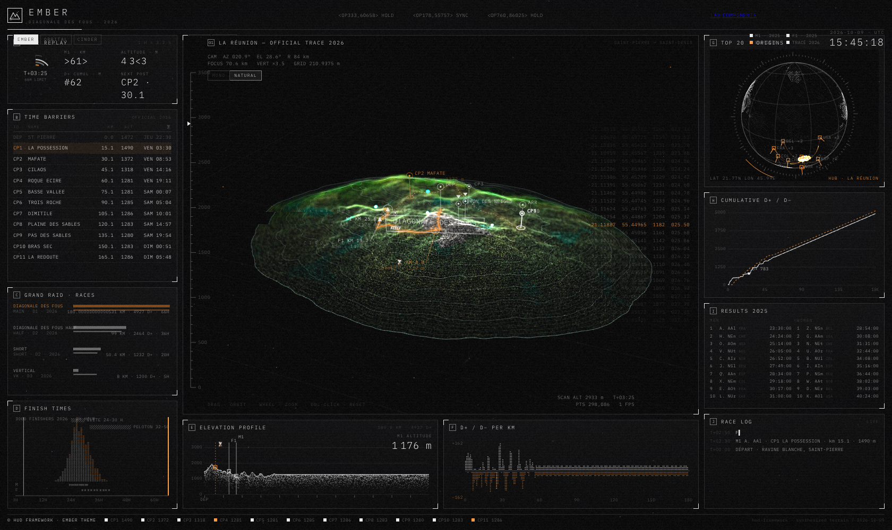
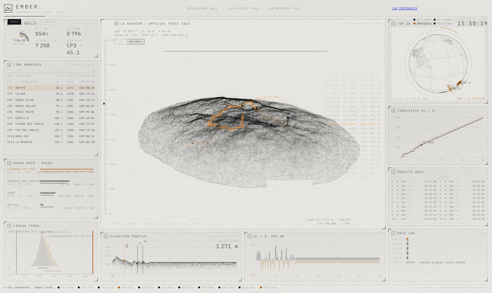
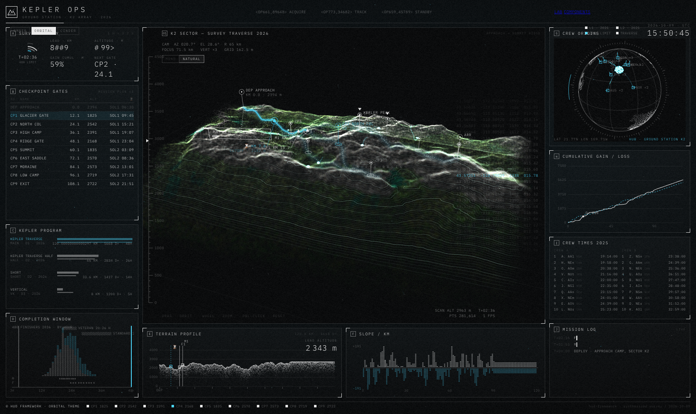
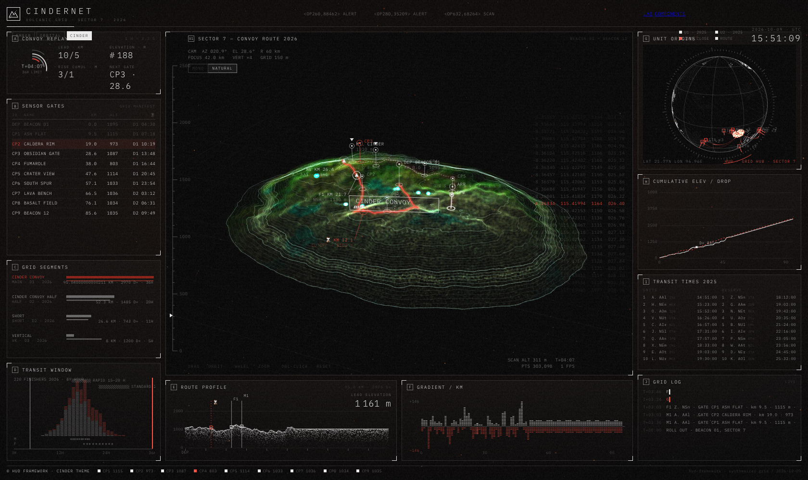
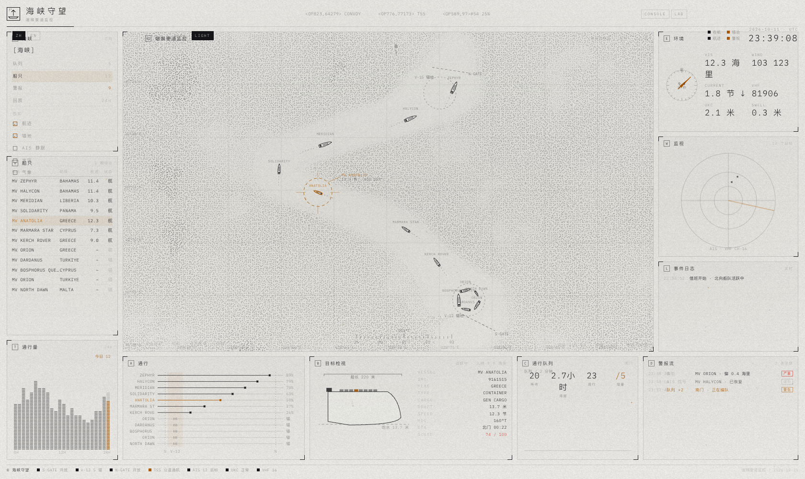
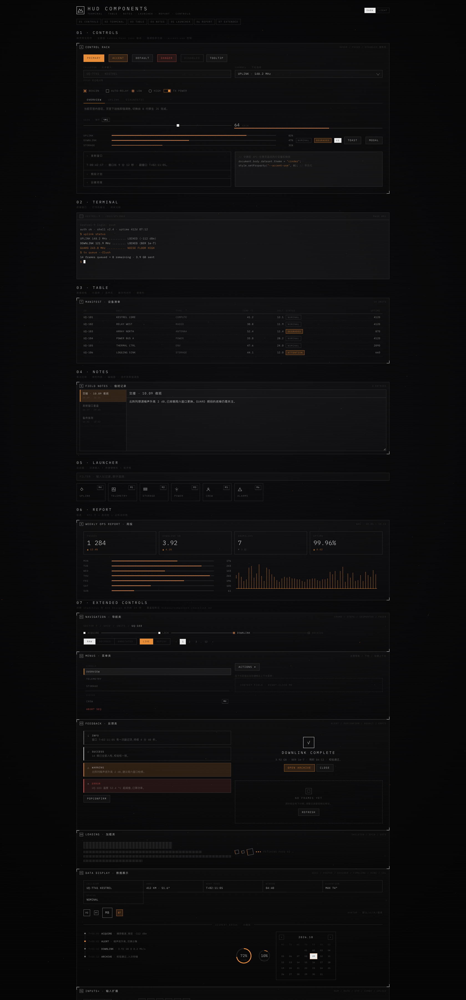

# HUD Console Framework

A sci-fi HUD console framework distilled from the aesthetic of [beastydesign/scifi](https://beastydesign.github.io/scifi/): design-token driven, dark/light dual-scheme, zero-dependency, no build step.

[中文版](docs/README.zh.md) · Live demo: <https://losecher.github.io/hud-console-framework/>

## Screenshots

| Dark console | Light paper+ink scheme |
|---|---|
|  |  |

| ORBITAL theme | CINDER theme |
|---|---|
|  |  |

Chokepoint watch (strait.html — vessel transit console, light paper scheme by default):



Full component library (terminal / table / notes / launcher / report + 24 extended controls mapped against shadcn/ui and Ant Design):



## Quick start

```bash
npm run dev        # -> http://localhost:7100 (or set PORT)
```

Any static file server works too — there is no build step.

## Pages

| Entry | Purpose |
|---|---|
| `index.html` | Main console demo (3D terrain + 2D instrument panels, 3 worlds × 2 styles) |
| `strait.html` | Chokepoint watch demo (vessel-transit traffic console — a "business skin" built on the core layers; write-up in [docs/custom-console.md](docs/custom-console.md)) |
| `components.html` | Component library (01 basics · 02 terminal · 03 table · 04 notes · 05 launcher · 06 report · 07 extended, 24 items) |
| `lab.html` | Token lab (spark particle params / line width / scheme switch, all reproducible via URL) |

URL params (every page): `?scheme=dark|light` `?linew=0.5..3` `?accent=rrggbb` (re-ink the accent hue, any theme).
Every page also accepts `?style=phosphor|paperlab` (not the lab, whose previews need the phosphor surfaces) `?motion=full|reduced` (defaults to `prefers-reduced-motion`; reduced turns off sparks/scanlines/grain/transitions) and `?fx=0|1` (scanlines, grain, sparks). Index and components accept `?density=compact|cozy`.
Index additionally accepts `?theme=ember|orbital|cinder`; legacy `?theme=paperlab` maps to `?theme=orbital&style=paperlab`. The lab's `?density=&ratio=&opacity=&comet=` are spark parameters.

**Theme vs style.** A *theme* (`themes/*.js`) is world content: copy, terrain, race data, default accent. A *style* (`styles/*.js`) is the visual language: grey ladder (alpha-derived `phosphor` vs solid `paperlab`), surfaces, atmosphere layers. They are orthogonal — any world can wear any style. Resolution order: style defaults → world accent (if the style has none) → user preferences → URL.

**Contrast check.** `npm run contrast` computes WCAG 2.x ratios for every theme × style × scheme (text 4.5:1, control accents and `--line-strong` 3:1), fails on any `color: var(--faint)` text (faint is non-text only), and checks `tokens/base.json §styles` against `styles/*.js`. `npm run check` = syntax check + contrast.
lab and components are bilingual (ZH/EN toggle in the top bar, auto-detected; override with `?lang=zh|en`).

## Directory layout

```
hud-framework/
├── index.html / strait.html / lab.html / components.html   four entry pages
├── server.mjs / package.json                 zero-dependency static dev server
├── assets/fonts/                             IBM Plex Mono (the only font, OFL license)
├── css/
│   ├── hud.css                               design tokens (:root variables) + page chrome
│   └── hud-components.css                    every hud-* control (token consumers only)
├── js/
│   ├── core/                                 business-agnostic reusable layer
│   │   ├── palette.js                        runtime color resolution: ink()/fgStr()/bgStr(), the basis of the dual scheme
│   │   ├── sparks.js                         accent spark-particle system (flow-field particles / comets)
│   │   ├── chrome.js                         top bar / footer / clock / grain overlays
│   │   ├── synth.js                          demo data synthesizer (not needed by adopters)
│   │   ├── glkit.js                          small WebGL2 helper library
│   │   └── util.js                           PRNG / noise / hash
│   └── views/                                demo-specific views (not needed by adopters)
│       ├── main.js                           console orchestrator
│       ├── terrain3d.js / globe.js / panels2d.js
├── themes/                                   theme configs (plain data objects, extend freely)
├── tokens/
│   ├── base.json                             single source of truth for design tokens
│   ├── component-checklist.md                coverage matrix vs shadcn/ui and Ant Design
│   └── scheme-analysis.md                    feasibility analysis of the dark/light schemes
└── docs/
    ├── README.zh.md                          中文说明
    ├── adoption.md                           ★ guide for adopting the framework in your own project
    └── optimization-review.md                overlap-mask / shader / performance review (vs pretext and paper-design/shaders)
```

## Core constraints (see docs/adoption.md)

- All colors flow through `tokens/base.json` → CSS variables → `palette.js`. **Never hardcode white/black**;
- One accent color `--accent` plus a semantic `--danger`; decorative color may only come from `spark.palette`;
- Depth is expressed only through lines, borders and corner brackets — no shadows, no rounded panels.

## License

MIT (see [LICENSE](LICENSE)). Fonts are IBM Plex Mono under OFL 1.1 (see [NOTICE.md](NOTICE.md)).
